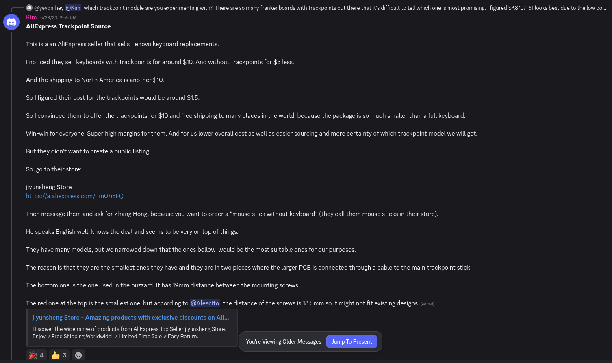
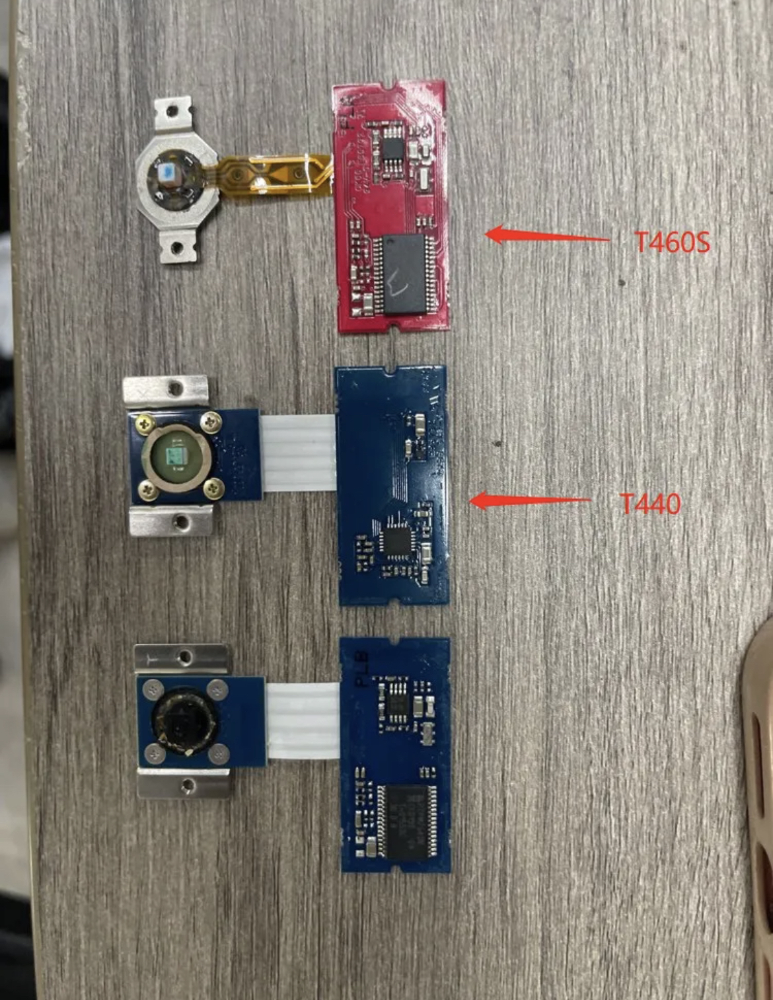

# Sourcing a Trackpoint Module

There's a few different ways to get a trackpoint module. Join the [Trackpoint Builder's Discord](https://discord.gg/48gM4jZkW) for the most up to date information!
## Option 1: Harvesting from a Thinkpad

If you have an old thinkpad laying around, you can extract the trackpoint module. There are github repos and other sources online to help identify the pinout of most modules so you know how to hook it up.

## Option 2: Aliexpress

There's a seller called **jiyunsheng Store** (http://aliexpress.com/store/5561177) that sells replacement thinkpad laptop keyboards (among other things). You can message them asking for just the trackpoint module. I paid ~$15 CAD for one from a T440. See [this zmk message](https://discord.com/channels/719497620560543766/845285481888743434/1112605096262508645) for details, copied below for reference:

## Option 3: Sprintek

A more recent option is to order a [Sprintek pointing stick module](https://www.sprintek.com/en/products/PointingStick.aspx), which uses more modern hardware and has significantly lower standby current, including the ability to properly enter deep sleep. However, shipping to Canada was obscenely expensive (would've been ~$70 CAD all in), which was more than I was willing to pay. But if you're in the USA, it should be more affordable!